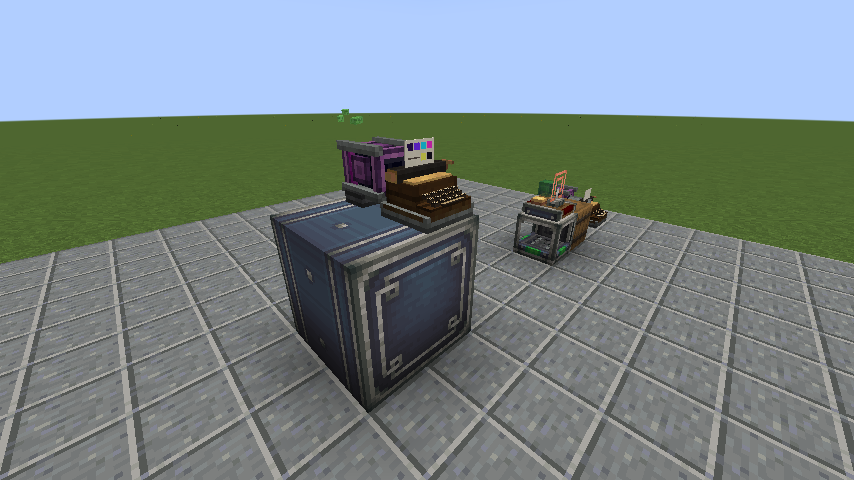
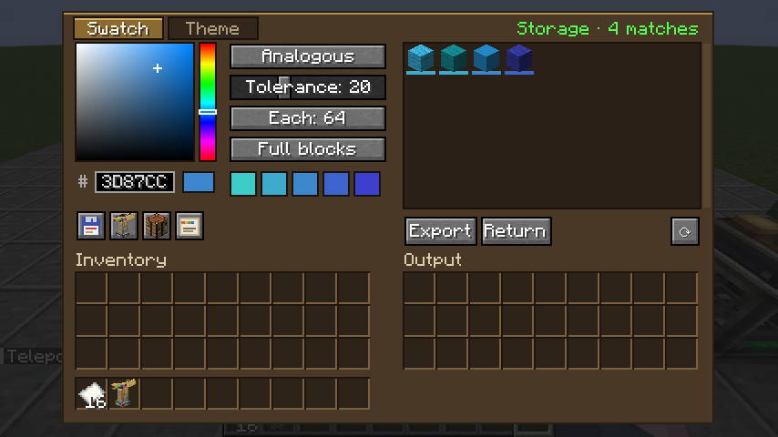
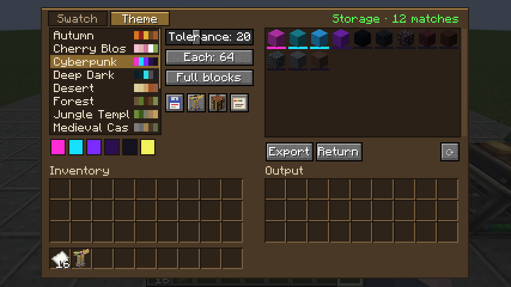
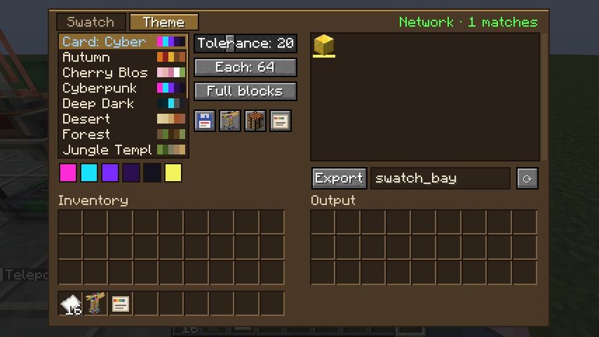
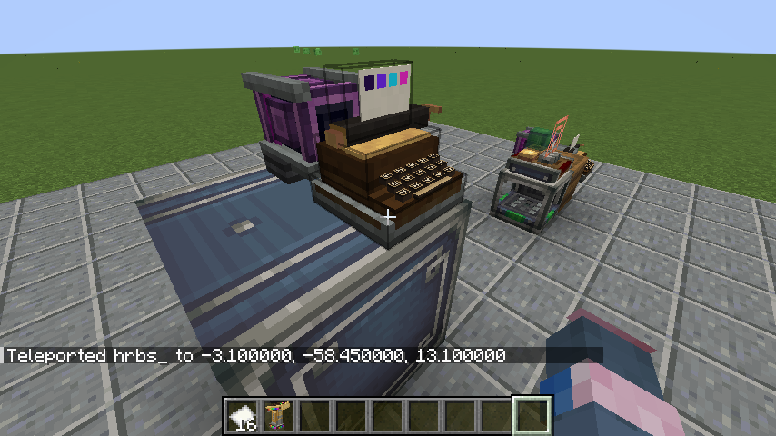
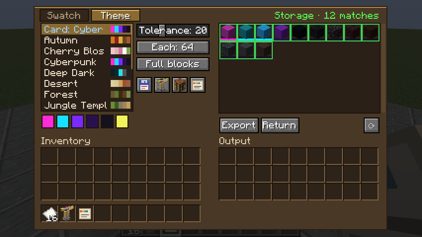
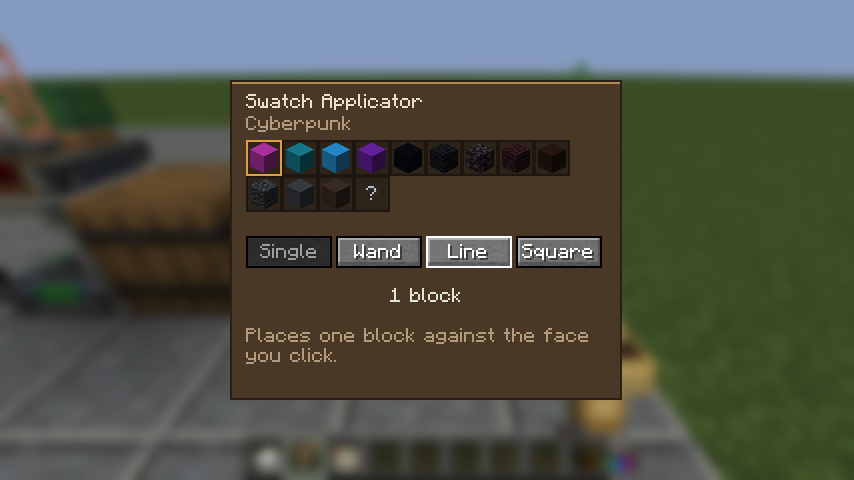

# CreateSwatches

A Create addon for builders. Put a **Swatch Typewriter** on your storage, pick a colour or a theme, and it pulls out the blocks that match.

NeoForge 1.21.1, Create 6.0.

## Swatch Typewriter

- Place it **on top of a vault, chest or any inventory** and it reads that inventory.
- Or **tune it to a logistics network**: right-click a Stock Link with the typewriter item (like a Stock Ticker), then place it anywhere. It reads the whole network's stock.
- It needs **rotation** through a shaft at its back. Stress impact is 1 SU per RPM (configurable).

### Swatch tab
Pick a colour (HSV square, hue bar or hex), then a scheme: single, monochrome, analogous, complementary, split complementary or triadic. Tolerance sets how close a block's colour must be (CIELAB). Each sets how many of every block to pull. Full blocks hides slabs, stairs and the like.

### Theme tab
14 built-in themes (Autumn, Cyberpunk, Steampunk, ...), plus your own saved themes from `<game dir>/createswatches/themes/`. The floppy button saves and loads swatches and themes as JSON.

### Export and Return
- **Storage mode:** Export pulls the picks into the typewriter's 27 output slots. Return puts them back.
- **Network mode:** type a delivery address. Export orders the picks as packages to that address. The typewriter accepts packages from funnels, chutes or a Frogport and unpacks them into its output.

Click blocks in the grid to choose exactly which ones export. With none selected, it takes the best matches for each palette colour in turn.

While it types, the carriage slides and the palette appears on the paper.

## Swatch Card
The card button types the current palette and picked blocks onto a Swatch Card (uses one paper). Use a card on any typewriter to open it on that palette.

## Swatch Applicator
Handheld placer. Load it from a typewriter with the applicator button. It places the selected block (or a random one from the palette), taking from the typewriter's output first and then the storage it sits on. In network mode, order blocks into the typewriter first.

- Shift + right-click: settings (block, Single / Wand / Line / Square, size)
- Shift + scroll: change block

## Recipes
- Swatch Typewriter: paper, 2 brass sheets, brass casing, shaft
- Swatch Applicator: electron tube, 2 brass sheets, brass hand, andesite alloy

## Config
`config/createswatches-server.toml`: rotation on/off, stress impact, card paper cost, applicator range.

## Building
`./gradlew build`. Textures and models come from `tools/typewriter_model.py` and `tools/applicator_texture.py`.

## License
MIT
